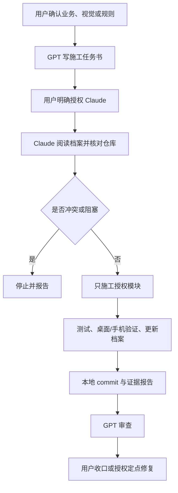

# LITUBO 官网 + CMS + AI 协作施工总则 V1

## 1. 协作目标

目标是“少返工、真实资料安全、前后台一致、每一步可验收”，不是追求一次写完所有功能。

## 2. 三方职责

| 角色 | 负责 | 不能自行决定或执行 |
|---|---|---|
| **用户** | 业务规则、真实型号/参数/证书确认、视觉确认、模块授权、关键网页登录、最终验收。 | 不需要判断代码实现细节。 |
| **GPT / Codex** | 全局蓝图、数据与权限逻辑、平面设计、模块拆分、Claude 施工指令、风险控制、报告审查。 | 不直接改项目代码、数据库、服务器或生产环境；不代替用户确认业务事实。 |
| **Claude Code** | 在用户本机读取项目档案、施工、测试、更新档案、创建本地 commit、提供证据。 | 不改变业务规则、不扩展范围、不公开资料、不处理凭证、不 push 或部署。 |

## 3. 宪法级规则

1. 仓库当前事实优先于聊天、旧报告和模型记忆。
2. 一次只施工一个**已授权**模块；平面设计确认不等于代码授权。
3. 发现范围外问题只能记录和报告；除非它直接阻断当前验收，否则不得顺手修改。
4. AI 永远只生成建议；不得自动覆盖已确认字段、发布、删除、移动正式媒体或发送对外资料。
5. 未验证型号、参数、证书、图片、翻译或 AI 输出只能保留在私有资料或 Draft，不能进入公开内容。
6. 未经用户明确授权，禁止 push、部署、发布、真实 AI 调用、外部邮件、真实 HubSpot 写入、支付或生产数据库改动。
7. 不读取、不输出、不保存 `.env`、密码、Cookie、Token、JWT、API Key 或浏览器凭证。
8. 测试资料必须标记 `TEST ONLY — NOT FOR PUBLICATION`。
9. 没有测试、1440px/375px 验证、Git 状态、commit 与项目档案更新，不得称为模块完成。

## 4. 标准模块生命周期



| 状态 | 含义 |
|---|---|
| `Planned` | 有任务书，尚未授权代码施工。 |
| `In Progress` | 用户已授权，Claude 正在执行。 |
| `Blocked` | 资料、权限、设计或仓库事实冲突，必须停下。 |
| `Completed` | 全部测试、视觉、文档、commit 和 GPT 审查均完成。 |

## 5. Claude 每次开工前的强制检查

```text
1. 阅读 CLAUDE.md
2. 阅读 docs/project/CURRENT-STATE.md
3. 阅读 docs/project/MASTER-ROADMAP.md
4. 检查 git status --short
5. 检查当前模块相关文件与必要服务状态
```

若已有不属于当前模块的改动，Claude 不得覆盖、格式化、移动或提交它们；必须先报告。

## 6. 必须停止并报告的情况

- 项目档案、代码、实际 schema、视觉母版或任务书互相矛盾；
- 需要新增/删除/迁移真实数据，或影响未授权模块；
- 需要真实 API Key、外部写入、部署、发布、邮件或支付；
- 无法证明 Draft、私有资料、AI 建议不会公开；
- AI 有跨型号读取资料、无证据参数或覆盖人工字段的风险；
- 1440px 或 375px 验收失败，且原因超出当前模块；
- 必须修改已确认视觉母版才能继续。

停止报告必须包含：阻塞点、已确认事实、不能自行决定的原因、影响、可选方案、需要用户确认的一句话。

## 7. 完工报告最低要求

```text
模块名称与结论（Completed / Blocked / Needs Fix）
实际完成内容与受影响文件
测试命令、结果、覆盖流程
1440px 与 375px 视觉验证
数据、权限、Draft/Published 门禁核对
git diff --check、git status --short、本地 commit hash
CURRENT-STATE.md / MASTER-ROADMAP.md 更新情况
已知限制、范围外发现、下一步需要用户决定的事项
```

## 8. GPT 审查规则

GPT 只接受以下四种结论：

| 结论 | 含义 |
|---|---|
| `接受收口` | 完成范围、测试与证据都足够。 |
| `需定点修复` | 指出一个明确缺口，形成新的小范围任务。 |
| `资料/规则待确认` | 先由用户决策，Claude 不继续。 |
| `证据不足` | 不能接受“已完成”，需要补测或补报告。 |

## 9. 模型与沟通规则

| 场景 | 推荐推理等级 |
|---|---|
| 明确的单页样式或局部修复 | 中等。 |
| 单模块前后端联动、CMS 页面、导入/状态机、视觉验收 | 高。 |
| 数据迁移、权限、发布机制、AI 边界、跨模块架构与上线前审查 | 最高。 |

- 模型只在模块开始时选择，中途不随意切换；需要切换必须先说明原因。
- GPT 先给结论与用户要决定的事项；Claude 在开工、阻塞和完工三个节点提供可核对信息。
- 每次视觉确认最多提交两张新页面；不要把大量未确认页面混在一次确认中。

