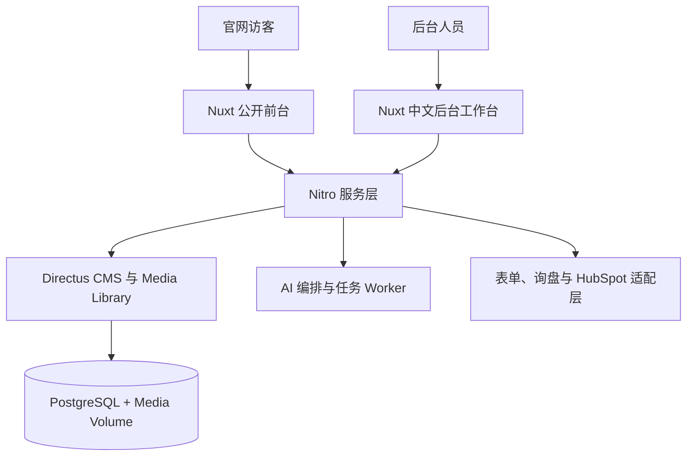

# LITUBO 官网 + CMS + AI 系统蓝图 V1

**状态：** 逻辑架构与施工边界基线。  
**不授权：** 本文件不授权数据库迁移、真实 AI Key、外部 HubSpot 写入、真实资料导入、部署或发布。  
**冲突规则：** 仓库事实和 `CURRENT-STATE.md` 优先；任何冲突都必须停止并报告。

## 1. 总原则

> 原始资料是证据；人工确认后的结构化 Product Truth 才是产品唯一可信事实；官网、PPT、Datasheet、报价、邮件和视频只能从对应版本的可信事实生成 Draft。

- 公开网站只读取经过安全过滤的 Published Revision。
- 产品通用事实与客户项目事实严格分开。
- Directus 是 CMS 数据与 Media Library 底座；Nitro 是权限、状态机、导入、AI 编排、发布与公开读取的门禁层。
- 不在 Nuxt、HubSpot、AI 输出或缓存中维护第二套产品真相。

## 2. 系统关系总图



浏览器不能直接连接数据库、通用 Directus 写接口、AI Provider、HubSpot 或媒体底层存储。涉及产品导入、AI、资料可见性、审核、发布与公开读取的业务动作，都必须经过 Nitro 服务层。

## 3. 组件职责与数据所有权

| 组件 | 负责 | 不负责 |
|---|---|---|
| Nuxt 公开前台 | 官网页面、SSR/SEO、已发布产品/资源、公开表单。 | 读取 Draft、审核、AI 或直连 Directus。 |
| Nuxt 中文后台 | 产品、资料、导入、审核、AI 队列的管理界面。 | 直接写数据库或绕过权限。 |
| Nitro 服务层 | 权限、状态机、公开 DTO、导入、AI 编排、审核、发布、表单接收与 HubSpot 同步控制。 | 存一套独立产品主数据。 |
| Directus + PostgreSQL | CMS 主数据、关系、Revision、媒体 UUID、内容与资源持久化。 | 让浏览器任意改写受治理对象。 |
| Media Library | 文件 UUID、版本、引用、生命周期与媒体元数据。 | 因为“被关联”就自动公开。 |
| AI Worker | 在一个冻结资料快照中产生建议、证据、冲突和完整度。 | 读取全库、改 Confirmed 字段、发布、发邮件或移动正式媒体。 |
| HubSpot | CRM 跟进事实与销售流程。 | 产品参数、媒体、AI 知识库或公开网站事实。 |

## 4. 核心对象关系

```text
Product Family（可选分组）
  └─ Product（一个可对外识别的 product_code）
       └─ Product Revision（draft → review → published → archived）
            ├─ Product Truth：经人工确认的字段
            ├─ Specifications / Page Modules / FAQ / SEO
            ├─ Media Relations（仅 UUID + 角色）
            ├─ Resources / Applications / Related Products
            └─ Source Evidence / Audit

Import Batch → Staging Rows → 多个独立 Draft → 单型号 AI Dossier 队列
Technical Matching / Inquiry → 产品候选或 Revision 快照（不反写 Product Truth）
```

产品、系列、Revision、客户项目和询盘不得互相混用。客户的包装、速度、报价、选配、FAT 和交付文件默认属于 Project，不是通用官网产品参数。

## 5. 前后端读取与写入契约

### 5.1 公开前台

公开页面只使用 Nitro 的 Public Read DTO，且 DTO 必须过滤：

```text
Published Revision + 已审核语言 + 已批准公开的媒体/资源 + 非 archived
```

允许的字段：slug、名称、分类、Hero、概览、能力、公开规格、公开图库、资源、应用、FAQ、CTA、SEO。  
禁止输出：Draft、来源证据、私有媒体、审核意见、AI 置信度、客户资料、报价、Directus 权限信息。

### 5.2 后台工作台

后台使用命令式业务接口，而非任意 PATCH 原始表：

```text
创建 Draft / 新 Revision
绑定来源资料 / 冻结 source snapshot
运行 AI Dossier
接受、编辑后接受、拒绝 AI 建议
提交 Review / 发布 / 撤回 / 归档
创建导入批次 / 确认预览 / 创建多个 Draft
```

每个写操作必须经过角色、状态、资料范围、乐观锁、审计与幂等检查。

## 6. 核心工作流

| 编号 | 流程 | 固定门禁 |
|---|---|---|
| W1 | 公开产品读取 | 只读 Published Revision 与已批准公开嵌套资源；前台/SEO/sitemap 同一来源。 |
| W2 | 手工产品编辑 | 新建 Draft 或新 Revision，按类别 Schema 填写；不能原地改已发布内容。 |
| W3 | 媒体治理 | 上传默认私有 → 内部复用或批准公开 → UUID 引用 → 引用检查后归档。 |
| W4 | 单型号 AI Dossier | 一个 Draft + 明确资料范围 → source snapshot → AI 建议/证据 → 人工确认。 |
| W5 | 多型号导入 | 固定工作簿 → staging/映射/预览/校验 → 多个 Draft → 按型号逐个 AI 审核。 |
| W6 | 发布与替换 | Review 通过 → Publisher 发布 → 原子切换 Published Revision → 刷新缓存与 sitemap。 |
| W7 | 询盘与 CRM | 表单服务端校验/保存 → Outbox → HubSpot 同步/重试；CRM 失败不让访客重复提交。 |
| W8 | 回滚与归档 | 旧 Published Revision 可回滚；Archived 排除公开 API/sitemap；无替代产品返回 410。 |

## 7. 状态机

| 对象 | 正式状态 |
|---|---|
| 产品 Revision | `draft → review → published → archived`；完整度、缺资料、冲突均为计算或问题状态。 |
| 导入批次 | `uploaded → parsing → mapping_required → validation_ready → preview_confirmed → creating_drafts → review_queue_ready → closed`；异常为 `failed/cancelled`。 |
| AI Run | `queued → running → completed/failed/cancelled/stale`。 |
| AI Suggestion | `proposed → human_confirmed/human_edited/rejected/needs_resolution`。 |
| 媒体 | `private source → internal reusable → approved public → archived`。 |
| HubSpot 投递 | `received → sync_pending → synced/retryable_failed/permanently_failed`。 |

## 8. AI 与资料边界

一次 AI 任务的最小合法范围：

```text
一个 product_code
+ 一个 product_draft_id
+ 一个冻结 source_snapshot_id
+ 一个 schema_version
+ 一次可审计 task
```

快照记录明确的媒体 UUID、文件版本/hash、PDF 页码、Excel Sheet/单元格范围。无法判断归属的资料必须标记待人工归属，不能进入 AI 上下文。

AI 可使用：当前快照、字段模板、单位规则、品牌术语、已明确授权的系列通用资料。  
AI 不可使用：其他型号事实、全媒体库、客户询盘、客户附件、私有报价、未关联证书/图片。  
AI 只写 Candidate/Suggestion + Evidence + Conflict；人工确认后的字段才成为 Product Truth。

## 9. 安全、失败与恢复

- Nitro 负责 CSRF、限流、角色、状态、公开白名单、导入与发布检查；不能只靠前端隐藏按钮。
- 产品发布不能自动公开关联的原始 PDF、图纸、证书或客户资料。
- 已发布 Revision 必须固定引用明确媒体版本，禁止静默替换同 UUID 文件改变历史页面。
- AI 失败保留 Draft 和快照，可重试；不得影响已确认字段。
- HubSpot 失败保留 Inquiry 与 outbox 记录，可重试；不得造成客户重复提交。
- Directus 失败不得在生产环境悄悄回退到测试 fixtures；必须返回受控错误或使用已验证缓存。
- 询盘、Technical Matching、报价和客户附件默认不进入 Product Dossier、公共知识库或训练集。

## 10. 现阶段后置内容

不在 V1 施工范围：复杂 Variant/BOM/价格配置器、任意 Excel 自由识别、客户门户/多租户 UI、自动多语发布、视频 API、模型微调、客户资料训练、HubSpot 双向同步、外部开发者 API。

一期仍应在数据层预留 `organization/workspace` 隔离能力，但不开放客户自助后台。

