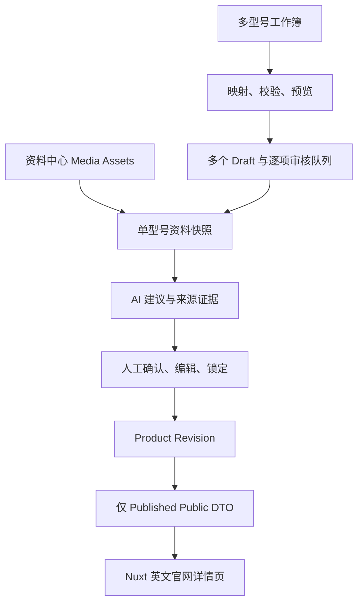

# LITUBO CMS + AI 后台视觉参考与页面地图 V1

## 1. 适用边界

- 后台操作语言为中文；英文仅用于稳定实体、字段副标签和官网预览。
- 公开官网一期以英文为主；后台预览必须使用真实官网页面结构。
- 日常后台是定制 Nuxt Admin；Directus 是 CMS/媒体/主数据底座，不应成为操作员绕过审核规则的日常入口。
- AI 真正填写和生成建议的唯一工作面是：**单个 Product Draft 的 Product Dossier**。
- 多型号工作簿只做导入、映射、校验、创建多个 Draft 与逐项审核队列；不能把多型号交给一个 AI 上下文，不能批量生成详情页或自动发布。



## 2. 视觉不变式

| 项目 | 固定规则 |
|---|---|
| 基调 | 冷白约 80–85%，浅蓝灰约 10–15%；工程化、留白充足、数据清晰，不做深色或营销式后台。 |
| 色彩 | 深绿 `#0F6B57`：标题、导航、确认态、重点细线；橙 `#C98500`：少量关键行动/提醒；红仅用于阻断错误。任何状态不可只靠颜色。 |
| AI 标识 | 可保留已确认亮绿色 AI 标识，但仅用于 AI 入口、范围锁定和任务提示，不能成为整页主色。 |
| 布局 | 桌面白色固定侧栏；顶部有面包屑、Revision 状态、保存状态；高风险页保留右侧“范围与人工控制”栏。 |
| 手机 375px | 侧栏变抽屉；主体改单栏；固定“保存草稿 / 下一步”；资料范围、阻断错误、接受/编辑/拒绝不得隐藏。 |
| 真实性 | 未有真实资料时，只用 `Product Draft #001`、`Media #001`、`Import Workbook #001` 等中性占位，不虚构型号、参数、证书、客户名或图片。 |
| 官网预览 | 可在后台以 1440/375 切换显示；手机端不压缩桌面预览，改用切换标签。 |
| 状态覆盖 | 每页都定义空、加载、无权限、失败、过期、冲突、成功、归档状态。 |

## 3. 一期菜单地图

```text
工作台
产品中心
  ├─ 全部产品
  ├─ 新建单型号 Draft
  ├─ 多型号工作簿导入
  └─ 待审核 / 已发布版本
资料中心
  ├─ Media Library
  └─ 媒体详情与引用关系
AI 工作台
  ├─ AI 指挥台
  └─ 单次任务详情
询盘与技术匹配
设置
```

Content Center、项目/报价、客户门户不应在一期显示为空壳菜单。数据边界可以预留，但客户项目、报价、测试资料不能进入 Product Dossier 或反写官网产品事实。

## 4. 后台页面与数据对象

| ID | 页面 | 主要读取 | 允许动作 | 关键禁止 |
|---|---|---|---|---|
| ADM-01 | 工作台 | Draft、待审核、导入异常、AI/媒体/询盘摘要。 | 跳转、查看、分配。 | 不跨产品 AI 填表。 |
| ADM-02 | 产品中心 → 全部产品 | Product、当前 Revision、完整度、状态。 | 新建 Draft、筛选、建立导入任务。 | 不能从勾选项批量 AI 填表或发布。 |
| ADM-03 | 新建单型号 Draft | Category Template、编码规则。 | 输入 `product_code`、类别、初始 Draft。 | AI 不得猜测或创建产品身份。 |
| ADM-04 | Product Dossier → 总览 | 当前 Draft、Revision、完整度、锁定字段、资料快照摘要。 | 保存草稿、进入子工作区。 | 不能混入其他型号。 |
| ADM-05 | Product Dossier → 资料包与范围 | Media Asset、Dossier Source、可见性、来源位置。 | 关联资料、设角色、冻结快照。 | 不建第二套媒体；不使用未授权资料。 |
| ADM-06 | Product Dossier → AI 填表/证据 | 当前快照、Schema、Suggestion、Evidence、Field Lock。 | 接受、编辑后接受、拒绝、锁定。 | AI 不能直接写 Truth；无证据不可确认。 |
| ADM-07 | Product Dossier → 官网模块 | Confirmed 字段、公开媒体、固定模板、SEO Draft。 | 模块启用/排序、文案/图片角色、私有预览。 | 不是自由网页搭建器；私有资料不可用。 |
| ADM-08 | Review/版本/发布 | Revision 差异、审核记录、公开预览、审计。 | 提交、退回、发布、撤回、归档。 | 已发布内容不能原地编辑。 |
| ADM-09 | 多型号导入 | Import Template、私有工作簿 Media。 | 创建 Job、选择 Sheet/Profile。 | 不能创建 Published。 |
| ADM-10 | 映射与预览 | Staging、Schema、单位词典、冲突。 | 确认映射、人工修正。 | 预览前不写产品；AI 只建议映射。 |
| ADM-11 | 导入结果/逐项队列 | Import Row、Draft、完整度、资料范围、冲突。 | 分配审核人、打开一个 Dossier。 | 没有接受全部、批量生成/发布。 |
| ADM-12 | Media Library | Media UUID、标签、引用、可见性。 | 上传、元数据、归档申请、选择关联。 | 不物理删除被引用媒体。 |
| ADM-13 | 媒体详情 | 单一媒体 UUID、版本、全局引用、来源位置。 | ALT、标签、可见性、归档申请。 | “允许 AI 读”不等于“允许公开下载”。 |
| ADM-14 | AI 指挥台 | 任务摘要、当前对象、审计、失败状态。 | 排序、取消、重试、打开 Dossier。 | 不直接编辑产品字段。 |
| ADM-15 | AI 单次任务详情 | 单个 AI Run、冻结快照、模块范围、Suggestion、Evidence、失败/成本摘要。 | 查看、取消/重试（有权限时）、跳转 Dossier。 | 不扩大资料范围，不在此页接受全部建议或发布。 |
| ADM-16 | 询盘列表 | Inquiry、归属、同步状态。 | 分配、备注、重试。 | 询盘不自动成为产品资料。 |
| ADM-17 | 技术匹配详情 | Inquiry、项目、已发布产品引用。 | 内部 Draft、备注。 | 不得修改 Product Truth 或公开项目资料。 |
| ADM-18 | 设置 → Schema/词典/Profile | Category Template、字段、单位、页面规则。 | 受控配置版本。 | 不能静默影响已发布内容。 |
| ADM-19 | 设置 → 角色/语言/品牌/AI | Role、locale、品牌规则、AI Policy。 | 权限和策略。 | Key 只显示已配置/未配置，不显示明文。 |

## 5. 后台与官网详情页模块契约

后台结构化数据必须一一对应官网详情页：

```text
Hero
→ Overview
→ Capability Modules
→ Specifications
→ Gallery & Resources
→ Applications / Case Studies
→ FAQ
→ CTA
→ SEO
```

后台保存字段、媒体 UUID、资源引用和模块配置；Nuxt 官网只读取 Published Revision 的安全 DTO。Draft、Review、私有 PDF、内部图片、AI Candidate、客户项目资料绝不进入公开路由、sitemap 或搜索引擎。

## 6. AI 视觉硬边界

任何 AI 入口必须显示：

```text
当前对象：Product Draft #001
产品编码：product_code
资料快照：Source Snapshot #001
字段模板：Schema Version
允许资料：已关联文件及可见性摘要
允许输出：参数 / 文案 / FAQ / SEO / 图片角色建议
人工控制：接受 / 编辑后接受 / 拒绝 / 锁定
```

- 一个 AI Worker 只接受一个 Product Draft + 一个冻结资料快照；
- 多型号可以排队，但每个型号独立生成、独立确认；
- 已确认字段显示锁；重新生成只产生新建议版本；
- 资料归属不明、证据冲突、快照过期必须显示为阻断；
- AI 指挥台只管任务，实际填写与确认回到 Product Dossier；
- 多型号导入结束按钮应为“创建 Draft 并进入逐项审核”，不能叫“批量 AI 填写”。

## 7. 视觉文件索引

| 文件 | 适用页面 | 状态 |
|---|---|---|
| `docs/design-reference/CMS-AI-VISUAL-MASTER-V1/logic-references/01_single_product_dossier_workbench.png` | ADM-04 至 ADM-08 的单型号工作台逻辑与层级。 | 当前参考。 |
| `docs/design-reference/CMS-AI-VISUAL-MASTER-V1/logic-references/02_multi_model_import_ai_review_queue.png` | ADM-09 至 ADM-11 的导入后逐项审核队列。 | 当前参考。 |

此前已确认的官网桌面视觉母版未在当前工作区提供。Claude 在处理 Home、Products、Applications、Product Detail、Resources、About/Contact 等公开页面时，必须取得原始母版图；不得以本后台图代替或自行猜测。

## 8. 后续平面图命名与确认顺序

文件名规则：

```text
LITUBO_CMS_{PAGE-ID}_{PAGE-SLUG}__{STATE}__{VIEWPORT}__v{NN}.png
```

每次最多确认两张主页面；桌面为 1440px、手机为 375px，必要抽屉/弹窗为附图。推荐顺序：

1. 共用 Shell + 状态规范；
2. 产品中心 + 新建 Draft；
3. 单型号总览 + 资料包范围；
4. AI 字段证据 + 官网模块预览；
5. 多型号导入 + 映射/校验；
6. 导入结果队列 + AI 指挥台；
7. Media Library + 媒体引用保护；
8. Review/发布/Revision 差异；
9. 询盘列表 + 技术匹配详情；
10. Settings 页面组。
