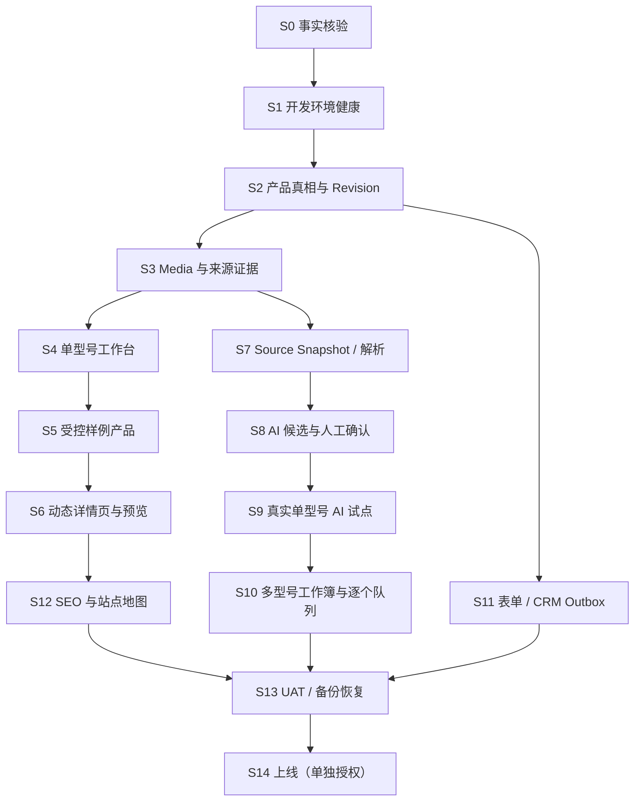

# LITUBO CMS + AI 施工路线与任务清单 V1

> 本文件是 Claude 的施工顺序，不是“看到就全部开工”的授权。每个阶段开始前，Claude 必须收到用户或 GPT 的明确任务单；仓库现状、`CURRENT-STATE.md`、已完成提交与服务状态永远优先于本路线图。

## 0. 总施工原则

- 每次只施工一个可验收模块；不跨模块顺手重构。
- `Product Truth` 只能由人工确认的结构化字段构成；AI、导入、解析均先产生候选与证据。
- 任何涉及真实模型、真实 API Key、HubSpot 写入、邮件发送、线上发布、物理删除、收费服务，均须单独授权。
- 后端先建立数据边界、状态机、权限与审计，再接前端页面；前端不得绕过 API 直接写 Directus。
- 任何公开 API、站点页面、站点地图只读取 `published` Revision + 已批准公开资源。
- 每个阶段结束均按 `01_COLLABORATION_PROTOCOL.md` 和 `05_CLAUDE_MODULE_WORK_ORDER_TEMPLATE.md` 提交证据，不以“页面能打开”代替验收。

## 1. 推荐依赖顺序



若 S0 发现相同功能已存在，则 Claude 必须把该阶段标为“已实现 / 待补证据 / 有缺口”，而不是重做。

## 2. 阶段任务单

### S0 — 现状事实核验与差异清单（先做，纯只读）

**目标**：让后续决定建立在实际仓库、实际数据库模式、实际服务状态之上。

**Claude 要做**：

- 读取 `CLAUDE.md`、`docs/project/CURRENT-STATE.md`、`docs/project/MASTER-ROADMAP.md`、`package.json`、Compose/Directus 配置和现有迁移；查看 `git status`、最近提交、可用服务健康状态。
- 建立“已完成 / 部分完成 / 未做 / 不确定”的差异表，特别核对 Product、Revision、Media、公开 API、预览、AI、导入、HubSpot、9A/9B。
- 不修改代码、不重启服务、不写数据库、不推送。

**验收输出**：一份带文件与接口证据的差异报告、推荐的第一个实际施工模块、风险与阻塞项。  
**用户决策点**：确认 S0 的事实基线与下一模块。  
**禁止**：把口头设计当作已经实现。

### S1 — 开发环境、Directus 与本地恢复能力

**目标**：使本地 Nuxt、Directus、PostgreSQL、Media 存储可稳定启动，且恢复操作可验证。

**Claude 要做**：

- 仅根据 S0 确认的缺口修复开发环境；为健康检查、环境变量示例、启动说明补齐文档。
- 确认 Directus 保持私有/loopback，前台不直连数据库。
- 验证匿名访问无法读取原始私有媒体或后台集合。

**验收**：启动/停止步骤、健康端点、最小数据恢复演练与失败日志说明。  
**禁止**：重置数据库、删除卷、修改线上环境、暴露 Directus。

### S2 — Product Truth、Revision 与权限状态机

**目标**：落地“一条 Product 是一个公开型号；修改已发布内容必须创建新 Revision”。

**Claude 要做**：

- 建立/校正 Product Family、Product、Product Revision、Specification、Page Module、Relation、审核/审计数据模型及 API 服务层。
- 固定状态：`draft → review → published → archived`；完整度是计算结果，不是状态。
- 落地角色：编辑、审核、发布；未批准数据绝不进入公开 DTO。
- 对必要命令建立幂等、校验和审计日志。

**验收**：创建 Draft、送审、批准发布、已发布修改生成新 Draft、归档与拒绝非法跳转的测试证据。  
**用户决策点**：产品字段、权限人群、审核门槛。  
**禁止**：把客户项目/报价/测试资料写入 Product Truth。

### S3 — Media Library、可见性、引用保护与来源证据

**目标**：媒体有唯一 UUID、业务关系、可见性边界、来源追溯与安全回收。

**Claude 要做**：

- 实现/校正 `Media UUID` 与业务引用；业务记录只存 UUID，不存本地路径。
- 区分访问可见性、公开展示、公开下载；`is_public` 不能是唯一安全闸门。
- 维护资产版本/hash、引用计数、角色（Hero/Gallery/PDF/Certificate 等）、归档/恢复、物理删除保护。
- 让证据可以精确指向文件版本、PDF 页码、Excel Sheet/单元格范围。

**验收**：同一文件被多处引用；引用中不可物理删除；私有资源不经公开接口泄露；来源定位在后台可打开。  
**禁止**：自动迁移旧目录、直接永久删除、把原始资料提交 Git。

### S4 — 单型号 Product Dossier 工作台与私有预览

**目标**：把 AI 的真正工作地点固定为“一个 Product Draft + 明确关联资料包”。

**Claude 要做**：

- 完成中文后台的单型号工作台：身份、资料包、字段/规格、模块、资源、来源、检查、审核动作、私有预览入口。
- 路由与 API 必须携带明确的 `product_draft_id` / revision；资料选择只能来自该 Draft 已关联资料和被授权的 Family Shared Source。
- 依固定详情页槽位编辑，不能自由拼页面结构。

**验收**：1440px + 375px 截图；从一个 Draft 进入私有预览；另一型号资料不可见、不可选、不可被写入。  
**用户决策点**：字段组、页面模块、审核界面文案。  
**禁止**：全产品列表右栏出现可跨型号写入的自由 AI 输入框。

### S5 — 受控样例产品（例如 LT-180C，仅人工确认资料）

**目标**：在没有真实 AI 的情况下，先走完整人工可控闭环，证明数据模型和页面槽位正确。

**Claude 要做**：

- 用用户明确指定且人工核对的来源，录入一个非虚构/不臆测的 Draft 样例。
- 验证图片、参数、PDF、SEO、详情页模块与证据关系；保留导入/人工确认的操作痕迹。

**验收**：后台字段 → 私有预览 → Review 提交/打回的受控演练记录；公开发布、公开撤回 URL、sitemap 与 SEO 的验收留给 S6/S12。  
**禁止**：编造型号、技术参数、证书或图片归属。

### S6 — 动态公开产品 API、详情页和私有预览

**目标**：以发布 Revision 生成统一的英文产品详情页；预览只读指定 Draft，不改变公开站。

**Claude 要做**：

- 实现受限的 Public Product DTO、Nuxt 动态路由、固定模块映射、Hero fallback、资源展示/下载策略、preview token/会话保护。
- 使用真实 Media UUID/CDN 关系而不是本地硬编码图片。
- 公开页面只展示批准数据；空模块有清晰缺省策略。

**验收**：访问已发布/未发布/不存在产品的行为；预览隔离；1440 + 375 页面截图；无私有 URL 或原始文件泄露。  
**禁止**：在前台读取 Directus 管理接口，或让预览链接变成公开永久链接。

### S7 — Source Snapshot、文件解析与候选输入准备

**目标**：为 AI 建立可复现、可审计的原始资料快照，不先接真实模型。

**Claude 要做**：

- 为一次单型号任务冻结 `product_draft_id + source_snapshot_id + schema_version`。
- 从明确关联的 PDF/Excel/图片/资料包提取可用文本/元数据，记录版本/hash、页码、Sheet/单元格；识别无法读取、冲突、缺失。
- 建立可重跑的解析 Job、失败重试、人工重新绑定来源流程。

**验收**：来源变化后旧候选仍可追溯；两个产品相似文件不会混用；错误解析不写 Product Truth。  
**禁止**：全媒体库扫描、跨型号拼接事实、把解析输出直接发布。

### S8 — AI Suggestion、证据、冲突与字段锁定（先用可替换 mock/provider）

**目标**：不依赖真实模型密钥，先验证 AI 输出的数据库接口、人工确认和审计闭环。

**Claude 要做**：

- 建立 Suggestion/Candidate、Evidence、Conflict、Human Decision、Field Lock、Generation Version 数据与 API。
- “接受 / 编辑后接受 / 拒绝 / 锁定 / 仅重新生成本模块”均可回放。
- 已确认字段不会被后续生成覆盖；AI 只提议新版本。

**验收**：用模拟输出演示参数、Hero、FAQ、SEO 的建议与证据；冲突进入队列；锁定字段被尊重；审计可导出。  
**禁止**：AI 直接写 Product Truth、自动 publish、删除/移动正式 Media。

### S9 — 真实单型号 AI 试点（需要单独授权）

**前置授权**：模型供应商、账户/密钥、费用预算、数据发送范围、保留策略、试点型号和资料包必须由用户明确确认。

**目标**：在严格单型号范围里验证真实解析/生成价值。

**Claude 要做**：

- 在替换式 Provider Adapter 后接入真实模型；限额、超时、重试、脱敏/数据范围、成本与失败记录全可见。
- 只执行单个指定 Draft + frozen source snapshot；输出仍先进入 S8 的候选链路。

**验收**：一份真实试点运行记录（input scope、耗时、成本、建议、人工决定、无交叉污染证据）。  
**禁止**：默认把客户文件用于训练、批量自动调用、越权上传保密资料。

### S10 — 多型号 XLSX/CSV 工作簿导入与“逐个 AI 检查”队列

**目标**：让 Excel 像专业 PIM 导入：结构化导入多条 Draft，但 AI 永远逐个产品工作。

**Claude 要做**：

- 实现模板/Profile、字段映射、单位标准化建议、预览、错误/冲突报告、暂存区、仅写 Draft、导入审计。
- 推荐多 Sheet：`Products`、`Specifications`、`MediaPlacements`、`Resources`、`PageModules`、`Relations`、`SourceManifest`；`product_code` 是唯一主键。
- 导入成功后排入“逐个 Draft 的 AI 检查/建议”队列，每项各自绑定自己的 snapshot，不形成多型号混合 prompt。

**验收**：预览不写库；缺少主键/单位冲突/媒体不归属时阻塞；成功行只生成 Draft；每个 AI 队列项的来源范围独立。  
**禁止**：批量 AI 自由生成所有详情页、批量自动发布、用产品名/文件名猜身份。

### S11 — Contact / Technical Matching / Distributor 表单与 HubSpot Outbox

**目标**：客户提交可可靠入库；HubSpot 只是 CRM 同步目标，不成为产品事实来源。

**Claude 要做**：

- 表单先写内部 Submission/Inquiry，再由 Outbox/Adapter 可重试同步 HubSpot。
- 记录来源 URL、UTM、产品兴趣、失败状态；失败不得要求客户重填。
- 不把客户定制、报价、检测资料回写 Product Truth。

**验收**：模拟成功、失败、重试、幂等提交；内部记录存在且无敏感数据在浏览器日志泄露。  
**禁止**：未授权真实 HubSpot 写入、前端直连 CRM、修改未确认的 HubSpot 字段。

### S12 — 动态 SEO、Sitemap、重定向与公开资源规则

**目标**：发布内容以数据驱动进入搜索与分享；下线后可安全撤出。

**Claude 要做**：

- 用 Published Revision 生成 title/description/canonical/OG、结构化数据、sitemap、robots 和必要重定向。
- 资源是否公开展示/下载由批准状态和可见性规则决定。

**验收**：发布、撤回、归档后 SEO/站点地图/页面可见性结果正确；无 Draft 和私有预览 URL 被收录。  
**禁止**：从草稿生成公开 SEO、使用未经授权的图片或资料 URL。

### S13 — UAT、发布门槛、备份与恢复演练

**目标**：在上线前验证人、数据、状态、媒体、AI、CRM、SEO 的全链路和可恢复性。

**Claude 要做**：

- 完成角色权限、公开数据隔离、人工审核、媒体恢复、导入失败恢复、AI 失败恢复、HubSpot Outbox、移动端和无障碍基础检查。
- 整理 UAT 清单、已知问题、备份与回滚 Runbook。

**验收**：用户或指定审核人签署 UAT；至少一次非破坏性恢复演练；未解决风险有明确上线决定。  
**禁止**：把“能跑”当上线批准。

### S14 — 生产部署与首次发布（仅明确授权后）

**目标**：在可回滚条件下发布经过审核的数据和代码。

**Claude 要做**：

- 按经批准的部署清单执行；记录版本、迁移、环境、回滚点、发布产品清单与监控观察窗口。

**验收**：健康检查、关键页面、表单、媒体访问、回滚路径均通过；发布报告获得用户确认。  
**禁止**：自行推送、迁移生产数据库、发布产品、开启真实 AI 成本或对外通知。

## 3. 每阶段交付物最小集合

| 类别 | 必须内容 |
|---|---|
| 代码 | 最小必要改动、可回滚迁移、无关文件不动 |
| 数据 | schema/fixture/导入样例的来源与权限说明 |
| 接口 | 请求/响应、角色、错误码、幂等与审计说明 |
| 前端 | 1440px 与 375px 证据、空/错/无权限状态 |
| 测试 | 自动测试命令和结果；关键手工路径 |
| 文档 | 更新 `CURRENT-STATE.md`、模块报告、风险/未决项 |
| Git | `git status`、本地提交 hash；除非授权否则不 push |

## 4. 给用户的固定决策清单

以下决定不能由 Claude 猜测；GPT 应在进入相应阶段前集中呈给用户：

1. 产品字段字典、单位字典、必填项和发布完整度规则。
2. 角色、审核人、谁能发布/归档/恢复媒体。
3. 哪些资料可以公开展示、公开下载、仅内部可见、绝不外发。
4. 每个产品/产品族的资料归属与允许共享范围。
5. 单型号 AI 试点的型号、资料包、模型供应商、费用上限与数据出境范围。
6. 多型号工作簿模板、字段映射策略、错误处理和批量审核责任人。
7. HubSpot 字段映射、同步时机和是否启用真实写入。
8. 域名、部署环境、备份保存期、上线与回滚授权人。

## 5. 第一条可复制的 Claude 施工指令

在用户确认后，GPT 给 Claude 的第一条任务应只做 S0：

```text
执行 S0：现状事实核验与差异清单（只读）。
仓库：D:\\LITUBO-website。
先读 CLAUDE.md、docs/project/CURRENT-STATE.md、docs/project/MASTER-ROADMAP.md，检查 git status、依赖、Compose/Directus 配置、现有迁移和可用服务健康。
请输出：已完成/部分完成/未做/不确定的差异表；证据文件与命令；风险；建议的唯一下一模块。
不得修改文件、数据库、服务、环境变量；不得重启、push、部署或调用真实外部服务。
完成时按 05_CLAUDE_MODULE_WORK_ORDER_TEMPLATE.md 的完成报告格式提交。
```
