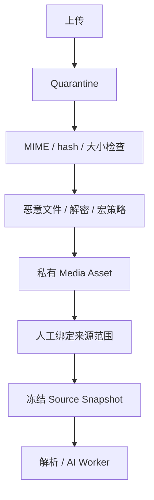

# LITUBO S2 前决策门、Schema Registry 与异步安全设计 V1

**状态：** S0 只读核验后、任何 S2+ 数据/权限/解析/AI 代码施工前必须冻结的目标设计。  
**原则：** 未确认的地方默认拒绝写入、拒绝公开、拒绝发送外部资料、拒绝启动真实任务；Claude 不可自行选择看似“常见”的实现。

## 1. 必须先回答的 7 个问题

| Gate | 必须确认 | 若未确认，Claude 的行为 |
|---|---|---|
| G-01 | Schema Registry 的最小实体与首个产品类别。 | 只做 S0，不创建产品字段迁移。 |
| G-02 | Reviewer 打回、再提交、职责分离规则。 | 不实现发布状态机。 |
| G-03 | 后台身份认证/会话/服务身份来源。 | 不新增角色保护 API 或 Worker。 |
| G-04 | 文件上传与解析隔离策略。 | 不接真实 PDF/XLSX/图片解析。 |
| G-05 | 持久队列/Worker/重试/死信方案。 | 不实现 AI、解析、Outbox 异步任务。 |
| G-06 | 英文 slug/locale 与 Content Center 一期策略。 | 不做公开动态详情页与多语结构。 |
| G-07 | Directus 可实现的关系/引用策略。 | 不建立 polymorphic `owner_type + owner_id` 伪外键。 |

S0 的任务是把“仓库已经怎样做”填入这些 Gate；GPT 再向用户集中提出选择，不让 Claude 边写边决定。

## 2. Schema Registry：产品不是自由 JSON

### 2.1 目标实体

| 逻辑对象 | 用途 | 生命周期/约束 |
|---|---|---|
| `product_categories` | 稳定产品类别，例如第一个试点类别。 | `category_code` 唯一；不可静默改含义。 |
| `category_schema_versions` | 某类别字段/模块规则的版本。 | `draft → active → deprecated → retired`；已用于 Revision 的版本不可原地重写。 |
| `field_definitions` | 一个 Schema Version 内每个字段的定义。 | `field_path` 在 Schema Version 内唯一；含类型、单位、校验、公开性、AI 能力。 |
| `unit_dictionary` | 标准单位、换算、显示规则。 | 单位 key 唯一；换算规则版本化。 |
| `module_definitions` | 固定官网槽位及可配置字段。 | 仅允许 `Hero/Overview/Capability/Specifications/GalleryResources/Applications/FAQ/CTA/SEO` 等白名单。 |
| `validation_rule_sets` | 完整度、送审、发布门槛。 | 每条 Revision 固化使用的 rule/schema 版本。 |

实际 Directus collection 名和 relation 以 S0 发现的现有模式为准；以上是不可丢失的逻辑对象。

### 2.2 `field_path` 统一语法

AI Suggestion、Human Decision、Field Lock、Audit 和前端表单必须共用同一条可校验路径，不能从显示中文名称猜字段。

```text
/identity/{key}
/overview/{key}
/specifications/{group_key}/{spec_key}
/modules/{module_key}/{field_key}
/seo/{key}
```

例子：

```text
/identity/model_name
/overview/summary
/specifications/inspection/detection_capability
/modules/hero/headline
/seo/meta_description
```

- `{key}` 只允许 `[a-z][a-z0-9_]{0,63}`；不使用中文、数组下标、临时 UUID 或任意 JSONPath。
- 对可重复媒体/资源，不使用 `field_path` 表达一整个数组；使用单独的 relation ID 和 role/sort 操作。
- `field_path` 必须在启用的 `category_schema_version` 中定义，否则 API 返回 `422 FIELD_NOT_IN_SCHEMA`。

### 2.3 字段类型与验证契约

| 类型 | 存储/输入 | AI 可建议 | 公开条件 |
|---|---|---:|---|
| `short_text` | Unicode 文本，长度上限。 | 是 | 人工确认 + 字段定义允许。 |
| `long_text` | 受限富文本/结构化 blocks。 | 是 | HTML/URL 消毒后 + 人工确认。 |
| `number` | 精度明确的数值。 | 是 | 证据、范围与单位校验通过。 |
| `quantity` | 数值 + `unit_key`。 | 是 | 单位词典与换算校验通过。 |
| `boolean` | true/false。 | 是 | 证据或人工确认。 |
| `enum` | 固定 value key。 | 是 | 只能取 Schema 指定值。 |
| `date` | ISO 日期。 | 原则上否（除非证据足够）。 | 公开策略明确。 |
| `media_relation` | 已存在媒体关系 ID。 | 仅可建议角色/排序。 | 媒体展示许可同时通过。 |
| `resource_relation` | 已批准 Resource ID。 | 仅可建议关联。 | Resource 与下载规则均通过。 |

`is_required_for_review`、`is_required_for_publish`、`public_visibility`、`ai_writable`、`requires_evidence`、`lock_after_confirmation` 都是 Field Definition 的版本化属性。AI 不可建议密钥、客户资料、报价、内部备注、访问控制、发布状态或媒体生命周期字段。

### 2.4 Schema 变更规则

1. 新字段/规则建立新 `category_schema_version`，不直接篡改已发布 Revision 的解释。
2. 旧 Revision 永远保留其 `schema_version`；迁移为显式、可审计、可回退任务。
3. Schema Draft 只有配置管理员能编辑；`active` 版本只有在测试通过后可启用。
4. 变更字段类型、单位或公开性属于高风险变更，必须产生兼容性/迁移报告。
5. 前端渲染只识别已批准固定模块；未知模块/字段安全忽略并记录后台问题，不在公开站渲染原始 JSON。

## 3. Review、打回与职责分离

### 3.1 明确转移表

| 当前正式状态 | 动作 | 执行人 | 新状态 | `workflow_step` | 说明 |
|---|---|---|---|---|---|
| `draft` | 提交审核 | Editor | `review` | `submitted_for_review` | 必须满足送审门槛。 |
| `review` | 打回 | Reviewer | `draft` | `needs_correction` | 记录原因；Editor 可编辑。 |
| `review` | 审核通过 | Reviewer | `review` | `approved_for_publish` | 是审计决定，不等于公开。 |
| `review` | 发布 | Publisher | `published` | `published` 或清空工作步骤 | 必须有有效审批、发布门槛与原子切换。 |
| `published` | 创建修改版 | Editor | 原 Published 不变；新 Revision `draft` | `source_binding_required` 或继承后的步骤 | 新 Revision 可引用旧 Revision，但不直接改线上版本。 |
| `published` | 撤回 | Publisher | `archived` | `withdrawn` | 需要 `withdrawn_reason`。 |
| `archived` | 回滚候选 | Reviewer + Publisher | 新建/恢复 Revision 至 `review` | `approved_for_publish` 前重新验证 | 不直接把历史数据库行悄悄改回 Published。 |

### 3.2 最小职责分离（SoD）

- Editor 可以编辑 Draft、接受或编辑后接受**自己权限范围内**的建议、提交 Review；不能审核通过或发布自己的 Revision。
- Reviewer 能打回/审核通过；不能直接改 Draft 内容（除非用户明确授权“reviewer 可编辑”并有独立审计）。
- Publisher 只能在有效 Reviewer 审核通过后发布、撤回、回滚；默认不应是同一 Revision 的 Editor 或 Reviewer。若小团队需要例外，必须记录 `segregation_exception_reason` 并获得用户审批。
- AI Operator 是**任务运行角色**：可发起/取消/重试 AI run 和查看结果，默认**不能接受、编辑、锁定建议**，除非同时拥有 Editor 角色；其角色表应分开显示。
- Media Steward 负责媒体生命周期/公开许可，不因可看文件而自动成为产品编辑者。

## 4. 身份、会话、服务账户：S0 后只能三选一

S0 应查明实际仓库已有的认证方式，GPT/用户再选择一条。禁止同时把 Directus、Nuxt 自建 session 与静态 token 混作权威。

| 方案 | 适用 | 必须确认的实现要点 |
|---|---|---|
| A. Directus Auth 为身份源 | 现有项目已经稳定使用 Directus 用户/角色。 | Nitro 服务端验证 session/token；后台不持有万能 Directus token；角色映射版本化。 |
| B. 独立后台 Auth 为身份源 | 项目已有企业 SSO/自建认证。 | 映射到内部 role/organization；Directus 仅为服务层数据底座。 |
| C. 外部 IdP 为身份源 | 已批准 OIDC/SAML/企业账号体系。 | OIDC 回调、group→role、注销/禁用、审计 actor ID。 |

无论哪一条：

- 浏览器使用安全 HttpOnly/SameSite 会话 cookie 或等价受控机制；后台写命令有 CSRF 防护。
- Worker 使用单独最小权限的 service account，不能复用用户 session，不能跨组织/全库读取。
- 后台 API 将 Actor、Role、Organization/Scope、Request ID 写入审计；无会话/无 scope 一律拒绝。
- 密钥只以环境变量名/已配置状态出现，不进入代码、日志、截图、任务报告或 Git。

## 5. 文件摄入、解析与 AI 输入安全

### 5.1 文件进入 Media Library 的隔离流程



| 检查 | 最低规则 |
|---|---|
| 文件类型 | 以魔数/MIME sniff 为准，不信任扩展名；只允许白名单类型。 |
| 大小/页数/单元格 | 设置可配置硬上限；超过上限拒绝或人工分片，不让 Worker 无限制消耗。 |
| Office 文件 | 宏文件、外链、嵌入对象默认拒绝/隔离；不执行宏；以安全解析库只读提取。 |
| PDF | 加密、密码保护、损坏、超页数、嵌入脚本明确标记失败/待人工处理。 |
| 图片 | 解码时限制像素/帧数；去除或隔离不可信元数据；不把 EXIF 位置公开。 |
| 恶意扫描 | 若生产要求 AV，选择已批准服务/基础设施；未决定时真实资料不进入自动解析。 |
| 文本输出 | 解析文字视为不可信输入；HTML/URL 消毒，禁止作为浏览器可执行内容。 |
| 错误保留 | 保留最小技术错误、hash、文件 ID、时间和操作者；不把私有内容写进客户端日志。 |

### 5.2 OCR、外部解析与 AI 资料发送

- V1 默认：不把扫描件、图纸、图片 OCR 发往外部；可标为 `needs_human_transcription`。
- 任何外部 OCR/AI 都是 D-06 的一部分，需要供应商、地区、数据保留和费用批准。
- Source Snapshot 只包含允许的 `media_id + version + locator`，不是 whole library；解析/AI Worker 只能基于该 manifest 读取受限字节或已抽取片段。
- 提示词/解析文本中的指令视为资料内容，不拥有系统权限；禁止文件内容改变工具/权限/发布行为。

## 6. 异步任务、持久队列与失败语义

AI、文档解析、缓存刷新和 HubSpot Outbox 都必须是持久任务；**不得**仅用 Nuxt 内存定时器、浏览器轮询或一次 HTTP 请求维持任务状态。

### 6.1 S0 后的实现选择

| 方案 | 条件 | 需要的最小能力 |
|---|---|---|
| 既有队列 | 仓库已有经验证的 Redis/DB/平台队列。 | durable job、worker、retry、dead-letter、监控。 |
| 数据库任务表 + Worker | 已有 PostgreSQL 且暂不引入新外部服务。 | `jobs` 表、行锁/claim、lease、幂等、定时 worker、死信表。 |
| 托管队列 | 用户授权新服务后。 | 访问控制、成本、地域、DLQ、审计、回滚计划。 |

选择一条后，所有异步域共用统一的 Job Contract：

```text
job_id, job_type, subject_id, source_snapshot_id?, payload_hash,
idempotency_key, status, attempts, max_attempts, lease_until,
next_attempt_at, error_code, trace_id, created_by, cancelled_at
```

状态：`queued → running → succeeded / retryable_failed / permanently_failed / cancelled / stale`。  
任务取消只停止未开始或安全中断点，不能回滚已经人工确认的事实；重试只重放同一冻结输入；重复点击靠 `idempotency_key` 返回同一 Job。超过最大次数进入 Dead Letter，必须有人工重放动作和审计。

## 7. 公开路由、语言与 Directus 关系落点

### 7.1 一期 EN 与 slug

V1 明确实施英文公开版本：

- `products.product_code` 是稳定身份；`product_revisions` 或其 locale 子对象保存可发布的 `slug`、`canonical_path`、`published_at`、`locale`。
- 约束：`(locale, slug)` 在当前 Published 公开范围内唯一；`slug` 不从 AI 自动写入 Published，AI 最多建议 Draft。
- EN 是唯一可公开 `locale`；ES/PT 只预留 locale 结构、默认不生成公开路由/sitemap/canonical，直到翻译审核策略另行批准。
- Public DTO 输出 `slug`, `canonical`, `published_at`（若公开需要），但不输出内部 Revision ID、source locator 或权限信息。

S0 后需在真实 schema 中选择“Revision 内 locale 表”还是“Revision 本身单语言”；不要同时维护两个公开 slug 来源。

### 7.2 Directus 关系的可实施方式

不要用不受数据库外键保护的通用 `owner_type + owner_id` 作为关键媒体完整性。优先顺序：

1. 对核心关系建立明确 junction collection，例如 `product_revision_media`, `product_revision_resources`, `content_item_media`；每条有真正 FK、role、sort、approval snapshot。
2. 若 Directus 的现有 schema 已有 M2M junction，复用其模式和权限；不得另起平行关系表。
3. 只有在无法避免的扩展关系中才使用 polymorphic reference，且要由服务层维护引用审计/保护；它不能作为删除安全的唯一依据。

## 8. S5 / S6 / S12 的验收边界修订

| 阶段 | 应验收 | 不应声称完成 |
|---|---|---|
| S5 样例产品 | 人工 Draft、来源绑定、完整度、私有预览、提交 Review 与后端状态演练。 | 公开详情页、sitemap、线上撤回 URL。 |
| S6 动态详情页 | Public DTO、Published 测试 Revision、私有预览隔离、公开/未公开页面行为。 | 搜索索引最终上线策略。 |
| S12 SEO | canonical、sitemap、robots、JSON-LD、撤回/归档后的公开路径与缓存策略。 | Search Console/生产提交（除非单独授权）。 |

## 9. 用户在 S0 后可一次性确认的提问清单

1. 首个产品类别与其字段/单位/必填项是否由你提供，还是先由 GPT 做一页“字段字典”供你批准？
2. 审核人、发布人是否必须和编辑人分离？小团队例外怎样记录？
3. 当前项目的后台登录/用户/角色以哪一套系统为准？
4. 真实文件是否允许自动解析？允许哪些类型、最大大小/页数、扫描件是否只人工处理？
5. 当前项目已有哪种可靠异步队列？若没有，是否接受 PostgreSQL 任务表 + Worker 作为 V1？
6. 一期 Content Center/Resources 是只读关联还是纳入受控编辑入口？
7. 撤回后 URL 采用 410、替代页还是重定向？

